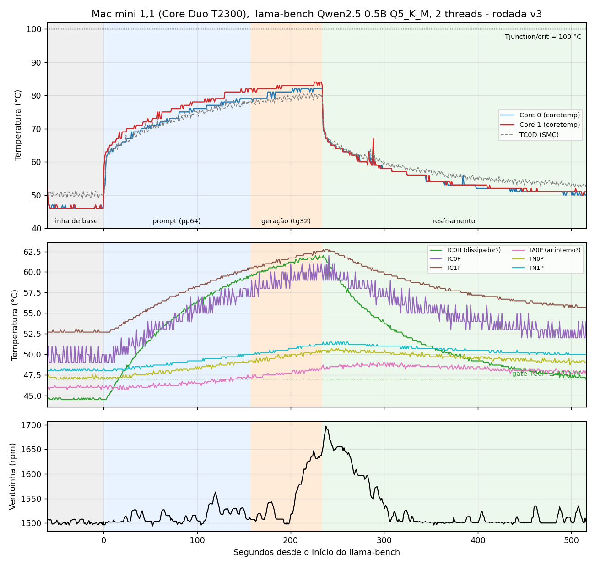

# Relatório térmico: llama.cpp no Mac mini 1,1 (Core Duo T2300)

Rodada única medida com `bench_termico_v3.sh`, em 03/10/2026 (início às 20:01, horário de Brasília).
Arquivos de origem: `meta.txt`, `log.csv`, `marcadores.csv`, `bench.csv`, `bench.err`, `resumo_bench.txt`, `sensors_inicio.txt`, `sensors_fim.txt`.



*Figura 1. Painel superior: núcleos (coretemp) e TC0D. Painel central: demais sensores do SMC. Painel inferior: ventoinha. Fundo: cinza = linha de base, azul = prompt (pp64), laranja = geração (tg32), verde = resfriamento.*

---

## 1. Resumo

- Com carga contínua de 2 threads, os núcleos sobem de ~46 °C (ocioso) para **82 °C (Core 0) e 84 °C (Core 1)** em ~234 s, a 16 °C do limite crítico de 100 °C informado pelo driver.
- Há duas escalas de tempo: os núcleos sobem rápido nos primeiros segundos (≥ 60 °C em 1,6 s) e depois lentamente, acompanhando o aquecimento do dissipador (`TC0H`: 44,5 → 62,0 °C).
- **Não houve throttling**: o contador `throttle_count` existe neste kernel e ficou em 0 durante todo o registro. A frequência informada sob carga foi constante (1 666,5 MHz).
- A ventoinha, em controle automático do SMC, mal reagiu: de 1 500 para um máximo de 1 697 rpm (limite do equipamento: 5 500 rpm), com atraso de dezenas de segundos.
- O resfriamento dos núcleos é rápido (≤ 60 °C em 40 s), mas o dissipador levou **282 s** para voltar a ≤ 47,0 °C. Ao fim, os sensores da placa ainda estavam 1,8 a 5,0 °C acima do início.
- Desempenho durante a medição: **1,642 t/s** no prompt e **1,276 t/s** na geração.
- Esta é **uma única rodada**: não há estimativa de variabilidade entre repetições.

---

## 2. Objetivo e escopo

Caracterizar o comportamento térmico do Mac mini 1,1 executando inferência de um SLM de 0,5B de parâmetros com o llama.cpp em 32 bits, e documentar o método de medição para que possa ser repetido.

Fora do escopo: consumo elétrico (ver seção 7), qualidade das respostas do modelo e integridade do arquivo do modelo.

---

## 3. Plataforma

| Item | Valor |
|---|---|
| Equipamento | Mac mini 1,1 (A1176 / EMC 2108) |
| CPU | Intel Core Duo T2300 (Yonah), 1,66 GHz, 2 núcleos, 65 nm |
| RAM | 2 GB DDR2-667 |
| Sistema | Debian 12 (i386), kernel `6.1.0-53-686-pae` |
| Governor de CPU | `performance` (informado no `meta.txt`) |
| Temperatura ambiente | 24 °C (informada pelo operador, medida fora do equipamento) |
| llama.cpp | 0.5.0-dev (ggml 0.25.3), commit `bed0a8566` |
| Compilação | GCC 12.2 em contêiner `debian:bookworm`, `-m32 -O3 -msse3 -mfpmath=sse`, sem SSSE3/SSE4/AVX/FMA |
| Modelo | Qwen2.5-0.5B-Instruct, Q5_K_M (arquivo de 522 186 592 bytes) |

**Valores de referência do fabricante.** TDP de 31 W e Tjunction de 100 °C (fonte: listagem de especificações do T2300 em `product.statnano.com/product/2360/intel-core-duo-(yonah)-cpu`, e TDP também em `technical.city/en/cpu/Core-Duo-T2300`). O driver `coretemp` informa `crit = +100 °C` para os dois núcleos (`sensors_inicio.txt`), coerente com o Tjunction. O TDP é uma especificação de projeto, não uma medida de consumo.

---

## 4. Metodologia

### 4.1 Instrumentação

| Grandeza | Fonte | Observações |
|---|---|---|
| Temperatura dos núcleos | `coretemp` (hwmon), `Core 0` e `Core 1` | Resolução observada de 1 °C (valores inteiros). |
| Temperaturas da placa | `applesmc`: `TA0P`, `TC0D`, `TC0H`, `TC0P`, `TC1P`, `TN0P`, `TN1P` | O log trunca para 0,1 °C. Os nomes seguem a convenção de chaves do SMC; a posição física de cada sensor **não foi confirmada**, e as interpretações (dissipador, ar interno etc.) são provisórias. |
| Ventoinha | `applesmc` (`Master`), rpm | Controle automático do SMC (sem forçar rotação). |
| Frequência | `scaling_cur_freq` de cpu0 e cpu1 | Valor informado pelo kernel, não medição direta. |
| Throttling | `thermal_throttle/core_throttle_count` | Soma dos contadores por núcleo; o script deixa a coluna vazia se o arquivo não existir (aqui existia: `throttle_disponivel: sim`). |
| Carga | `/proc/loadavg` (média de 1 min) | Referência apenas; é uma média defasada. |

**Amostragem.** Um laço em segundo plano grava uma linha por ~1 s em `log.csv`. Foram 569 amostras em 576 s (intervalo médio 1,014 s; mínimo 1,010 s; máximo 1,028 s). O laço usa apenas comandos internos do bash para minimizar a carga extra sobre a CPU medida. O relógio vem de `$EPOCHREALTIME`.

### 4.2 Protocolo da rodada

1. **Espera inicial por equilíbrio:** só inicia quando os dois núcleos estão ≤ `TARGET` (52 °C) **e** o dissipador (`TC0H`) ≤ `GATE_HS` (47,0 °C). Limite de espera: 1 200 s. Nesta rodada a condição já era satisfeita (núcleos 52 °C, `TC0H` 44,5 °C), então a espera foi de 0 s.
2. **Linha de base:** 60 s ocioso.
3. **Carga:** `llama-bench` (seção 4.3).
4. **Resfriamento:** mínimo de 60 s e até a mesma condição do passo 1 (núcleos ≤ 52 °C e `TC0H` ≤ 47,0 °C). Durou 282,6 s, limitado pelo dissipador.
5. **Registro final:** `sensors_fim.txt` e resumo dos mínimos, médias e máximos da janela de carga.

**Proteção.** Um vigia encerraria o `llama-bench` se algum núcleo atingisse `ABORT_C` = 95 °C. Não foi acionado (pico de 84 °C).

Parâmetros efetivos desta rodada (registrados no `meta.txt`): `TARGET=52`, `GATE_HS=47.0` (sensor `applesmc:TC0H`), `MAXWAIT=1200`, `MINCOOL=60`, `BASE=60`, `ABORT_C=95`, ventoinha automática.

### 4.3 Carga de trabalho

```
LD_LIBRARY_PATH=. ./llama-bench -m qwen2.5-0.5b-instruct-q5_k_m.gguf \
  -t 2 -p 64 -n 32 -r 3 -o csv
```

Parâmetros do `bench.csv`: lote `n_batch=2048`, `n_ubatch=512`, cache KV em f16, modo de carregamento `auto` (mmap), 2 threads. Dois testes em sequência: processamento de prompt de 64 tokens (pp64) e geração de 32 tokens (tg32), ambos com 3 repetições (`-r 3`).

### 4.4 Janelas de análise

O tempo zero é o marcador `bench_inicio`. Os limites entre fases vêm do campo `test_time` do `bench.csv` (início de cada teste, em UTC), convertidos para a mesma base de tempo do log.

| Janela | Intervalo (s) | Duração | Observação |
|---|---|---|---|
| Linha de base | −50 a 0 | 50 s | Descarta os primeiros 10 s dos 60 s de linha de base. |
| Carga total | 0 a 233,9 | 233,9 s | Inclui ~1,3 s de carregamento do modelo antes do pp. |
| Prompt (pp) | 1,3 a 157,3 | 156,0 s | Equivale a ~4 repetições de 39 s; isso sugere uma execução de aquecimento além das 3 repetições, mas não confirmei no código do llama-bench. |
| Geração (tg) | 157,3 a 233,9 | 76,6 s | |
| Regime final | últimos 60 s da carga | 59 s | Aproximação de regime quase estacionário. |
| Resfriamento | 233,9 a 516,5 | 282,6 s | |

### 4.5 Grandezas derivadas

- **Tempo até limiar:** primeiro instante após o início da carga em que o maior dos dois núcleos atinge o valor.
- **Tempo de resfriamento até limiar:** primeiro instante após o fim da carga em que o maior dos dois núcleos (ou o `TC0H`) fica abaixo do valor.
- **Diferença entre núcleos:** Core 1 − Core 0, instante a instante, durante a carga.
- Todas as médias e desvios usam as amostras da janela (desvio-padrão populacional).

---

## 5. Resultados

### 5.1 Linha de base (ocioso)

| Sensor | Média (°C) | Desvio | Mín–Máx |
|---|---:|---:|---|
| Core 0 | 46,1 | 0,30 | 46,0–47,0 |
| Core 1 | 46,1 | 0,32 | 46,0–47,0 |
| TC0D | 50,2 | 0,58 | 49,0–51,2 |
| TC0H | 44,6 | 0,09 | 44,5–44,7 |
| TC0P | 49,6 | 0,78 | 49,0–51,0 |
| TC1P | 52,7 | 0,11 | 52,7–53,0 |
| TA0P | 46,0 | 0,10 | 45,7–46,2 |
| TN0P | 47,1 | 0,13 | 47,0–47,5 |
| TN1P | 48,1 | 0,10 | 48,0–48,2 |
| Ventoinha (rpm) | 1 501 | 3,6 | 1 496–1 508 |

A primeira amostra do log (52/52 °C nos núcleos) é mais quente que o resto da linha de base e está com a CPU em frequência máxima; nas amostras seguintes a frequência cai para ~1,0–1,2 GHz e a temperatura para ~46 °C. É consistente com atividade imediatamente anterior ao início do registro, mas não verifiquei a causa.

### 5.2 Aquecimento

Tempo até limiar (maior dos núcleos):

| Limiar | ≥ 60 °C | ≥ 65 °C | ≥ 70 °C | ≥ 75 °C | ≥ 80 °C | ≥ 82 °C |
|---|---:|---:|---:|---:|---:|---:|
| Tempo (s) | 1,6 | 6,7 | 25,1 | 57,6 | 129,8 | 147,1 |

Média dos dois núcleos (janelas de 5 s a partir de cada instante):

| Instante (s) | 0 | 10 | 20 | 30 | 60 | 120 | 180 | 225 |
|---|---:|---:|---:|---:|---:|---:|---:|---:|
| Média (°C) | 60,0 | 65,4 | 67,5 | 69,4 | 73,1 | 78,0 | 81,3 | 82,9 |

O dissipador (`TC0H`) atingiu 55 °C aos 81 s, 60 °C aos 164,5 s e o pico de 62,0 °C aos 226,6 s. O Core 0 atingiu o pico (82 °C) aos 202,1 s e o Core 1 (84 °C) aos 225,6 s.

### 5.3 Regime final (últimos 60 s da carga)

| Sensor | Média (°C) | Desvio | Máx (°C) |
|---|---:|---:|---:|
| Core 0 | 81,4 | 0,73 | 82,0 |
| Core 1 | 82,9 | 0,57 | 84,0 |
| TC0D | 79,3 | 0,74 | 80,5 |
| TC0H | 61,2 | 0,49 | 62,0 |
| TC0P | 59,3 | 0,89 | 61,0 |
| TC1P | 61,8 | 0,48 | 62,5 |
| TA0P | 47,8 | 0,25 | 48,5 |
| TN0P | 49,9 | 0,31 | 50,5 |
| TN1P | 50,7 | 0,32 | 51,2 |
| Ventoinha (rpm) | 1 565 | 52,8 | 1 647 |

O Core 1 ficou em média 2,1 °C acima do Core 0 durante a carga (mínimo 1 °C, máximo 9 °C, este último no transitório inicial). Nem as temperaturas nem a ventoinha tinham se estabilizado por completo ao fim dos 234 s; o regime é apenas aproximado.

### 5.4 Prompt versus geração

| Sensor | pp (média / máx, °C) | tg (média / máx, °C) |
|---|---|---|
| Core 0 | 72,7 / 79 | 80,8 / 82 |
| Core 1 | 75,0 / 82 | 82,6 / 84 |
| TC0D | 72,0 / 78,7 | 79,1 / 80,5 |
| TC0H | 53,8 / 59,5 | 60,9 / 62,0 |
| Ventoinha (rpm) | 1 514 / 1 563 | 1 553 / 1 647 |

A fase de geração aparece mais quente, mas **isso não permite concluir que a geração esquenta mais que o processamento do prompt**: ela vem depois e a temperatura acumula com o tempo. Para separar os dois efeitos seria preciso inverter a ordem dos testes ou rodar cada um isolado, partindo do mesmo estado térmico.

### 5.5 Ventoinha

- Em repouso: 1 501 rpm (próximo ao mínimo de 1 500).
- Passou de 1 520 rpm aos 30,1 s de carga.
- Pico de **1 697 rpm** aos 237,8 s, ou seja, 3,9 s **depois** do fim da carga. A ventoinha reage com atraso.
- Voltou a ≤ 1 510 rpm cerca de 72 s depois do fim da carga.
- Nunca chegou perto do máximo do equipamento (5 500 rpm).

### 5.6 Frequência e throttling

| Fase | Frequência média informada (MHz) | Faixa (MHz) |
|---|---:|---|
| Linha de base (≥ 1 s) | 1 064 | 1 012–1 225 |
| Carga (230 amostras) | 1 667 | 1 667–1 667 |
| Resfriamento | 1 067 | 1 008–1 667 |

- Sob carga, a frequência informada foi **constante** em 1 666,5 MHz em todas as 230 amostras.
- Em repouso, o kernel informa valores entre ~1,0 e ~1,2 GHz, apesar do governor ser `performance`. Isso indica que a CPU reduz a frequência quando ociosa; não investiguei se é o hardware (estado de espera) ou o sistema. Consequência prática: a linha de base térmica corresponde a um estado de baixa frequência.
- Logo após o fim da carga (0,8 s), a frequência informada cai para ~1,0 GHz.
- `throttle_count` = 0 em todo o log.

### 5.7 Resfriamento

Tempo após o fim da carga:

| Limiar (núcleos, maior valor) | ≤ 70 °C | ≤ 65 °C | ≤ 60 °C | ≤ 55 °C |
|---|---:|---:|---:|---:|
| Tempo (s) | 1,9 | 9,9 | 40,3 | 112,0 |

| Limiar (`TC0H`) | ≤ 50 °C | ≤ 48 °C | ≤ 47 °C |
|---|---:|---:|---:|
| Tempo (s) | 135,3 | 213,1 | 281,8 |

Os núcleos caem rápido (o sensor reflete a temperatura do próprio chip, de pequena massa térmica) e depois acompanham a queda lenta do dissipador. A espera total de 282,6 s foi imposta pelo `TC0H` ≤ 47,0 °C.

Estado no início e no fim da rodada (de `sensors_inicio.txt` e `sensors_fim.txt`):

| Sensor | Início (°C) | Fim (°C) | Diferença |
|---|---:|---:|---:|
| Core 0 / Core 1 | 52 / 52 | 50 / 51 | −2 / −1 |
| TC0D | 50,0 | 52,5 | +2,5 |
| TC0H | 44,5 | 47,0 | +2,5 |
| TC0P | 49,0 | 54,0 | +5,0 |
| TC1P | 52,8 | 55,8 | +3,0 |
| TA0P | 46,0 | 47,8 | +1,8 |
| TN0P | 47,2 | 49,0 | +1,8 |
| TN1P | 48,0 | 50,0 | +2,0 |

Mesmo satisfeitas as condições de parada, os sensores da placa ainda estavam acima do início. Os sensores do ambiente interno e do chipset continuaram subindo depois do fim da carga (por exemplo, `TA0P` atingiu o pico de 49,0 °C aos 271,1 s, 37 s depois do fim). Uma rodada seguinte, iniciada logo após esta, começaria em um estado térmico ligeiramente mais quente.

### 5.8 Desempenho durante a medição

| Teste | Média (t/s) | Desvio (llama-bench) |
|---|---:|---:|
| pp64 | 1,6416 | 0,0045 |
| tg32 | 1,2757 | 0,0031 |

O desvio é entre as repetições do próprio `llama-bench`, não entre rodadas do protocolo.

---

## 6. Limitações e ameaças à validade

1. **Uma única rodada.** Sem repetições, não há estimativa de variabilidade entre execuções; diferenças de ±1 °C ou ±10 s entre rodadas futuras podem estar dentro do ruído.
2. **Resolução e exatidão dos sensores.** Os núcleos têm resolução de 1 °C. A exatidão absoluta dos sensores não foi avaliada, e a posição física dos sensores do SMC não foi confirmada.
3. **Diferença sistemática entre núcleos.** O Core 1 aparece cerca de 2 °C acima do Core 0, mas isso pode ser diferença de sensor, e não de calor real.
4. **Regime não estacionário.** A carga durou 234 s; temperaturas e ventoinha ainda variavam ao fim.
5. **Controle automático da ventoinha.** A rotação é decidida pelo SMC e responde com atraso; é uma variável não controlada (o script tem opção de fixar a rotação, não usada aqui).
6. **Estado térmico inicial.** O critério de espera (`TC0H` ≤ 47,0 °C) é mais frouxo que o estado observado no início desta rodada (44,5 °C); rodadas consecutivas podem começar com até ~2,5 °C de diferença no dissipador.
7. **Ordem fixa dos testes.** O prompt sempre precede a geração, o que impede comparar as duas fases termicamente.
8. **Frequência informada.** O `scaling_cur_freq` é o valor do kernel; a frequência real não foi medida de forma independente.
9. **Efeito do próprio registro.** O registro usa um pouco de CPU. O desempenho medido (1,64 / 1,28 t/s) é compatível com o de uma execução sem registro, mas isso foi comparado de forma informal.
10. **Integridade do modelo.** Não faz parte deste relatório. O `meta.txt` registra `sha256 = 2dddab7bdc8df1a9d278196a496113325ade9bfdbe0b449428429124ac40e22d` (duas leituras iguais), sem comparação com o hash publicado do arquivo.

---

## 7. Consumo e TDP

Esta medição **não inclui potência elétrica**: o Core Duo (Yonah) não tem o contador interno de energia (RAPL) presente em CPUs mais novas, e o Mac mini não oferece outra leitura de potência pelo sistema. O TDP de 31 W é a especificação térmica nominal do chip e não deve ser interpretado como o consumo medido durante o teste. Para obter energia por token seria necessário um medidor de tomada (potência média durante a carga menos potência em repouso, multiplicada pelo tempo e dividida pelos tokens gerados).

---

## 8. Reprodução

```bash
# Pré-requisitos (uma vez)
sudo apt install lm-sensors
sudo modprobe coretemp applesmc

# Execução (dentro da pasta bin, onde está o llama-bench)
cd ~/bin
AMB=24 ../bench_termico_v3.sh ~/qwen2.5-0.5b-instruct-q5_k_m.gguf
```

Variáveis principais: `TARGET` (núcleos, °C), `GATE_HS` (dissipador, °C) e `GATE_LABEL` (sensor do critério), `MAXWAIT`, `MINCOOL`, `BASE`, `ABORT_C`, `FAN_RPM` (opcional), `SKIPHASH`, `DROPCACHE`. Use os mesmos valores em todas as rodadas que forem comparadas.

Arquivos gerados em `termico_AAAAMMDD_HHMMSS/`: `log.csv` (série temporal), `marcadores.csv` (instantes de cada fase), `bench.csv` (saída do llama-bench), `meta.txt` (parâmetros e estados inicial e final), `sensors_inicio.txt` e `sensors_fim.txt`, `resumo_bench.txt` (mínimo, média e máximo na janela de carga).

Observação sobre os tempos: o `meta.txt` informa a espera final como `gate_fim_ok: sim`, e os marcadores `bench_fim` e `fim` permitem recalcular qualquer janela.

---

## 9. Pendências para fortalecer o estudo

1. Repetir a rodada pelo menos três vezes com os mesmos parâmetros e reportar média e desvio.
2. Rodar o `llama-bench` sem o registro, três vezes, para quantificar o efeito do script.
3. Repetir com `GATE_HS` mais baixo (por exemplo 46,0 °C) para reduzir a diferença de estado inicial entre rodadas.
4. Inverter a ordem pp/tg, ou medir cada fase isolada, para separar o efeito do tempo do efeito do tipo de carga.
5. Medir potência com um medidor de tomada, se for necessário reportar energia por token.
